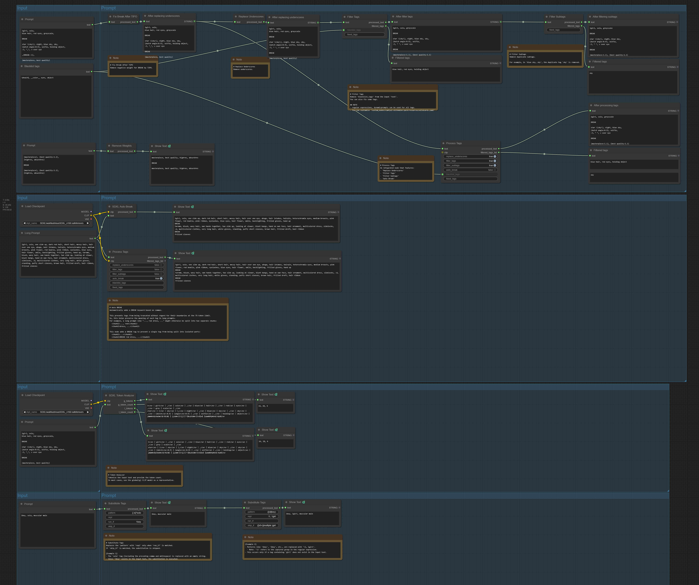
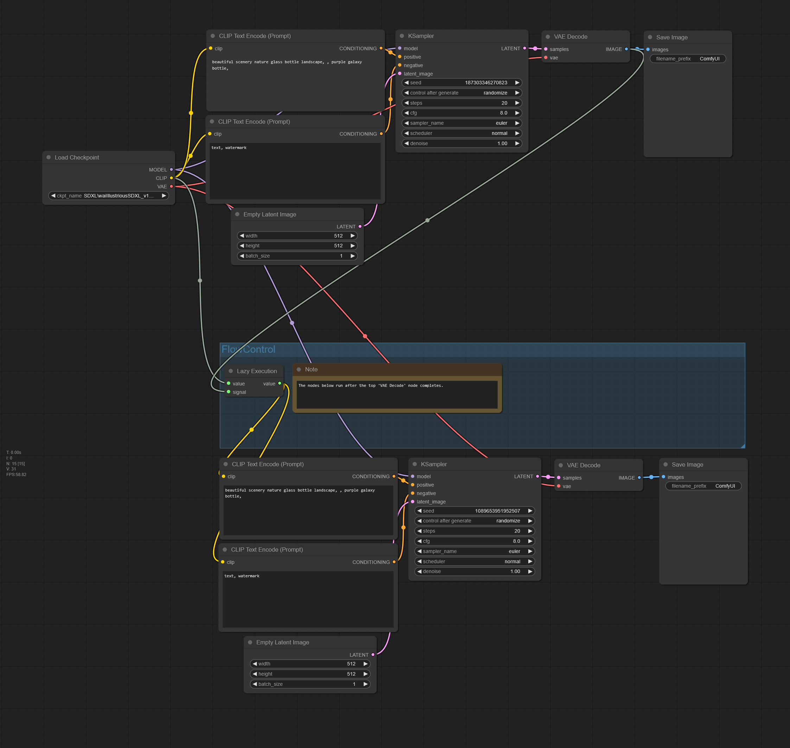

# ComfyUI-Alchemine-Pack

[ComfyUI](https://github.com/comfyanonymous/ComfyUI)를 위한 커스텀 노드 팩입니다. 프롬프트 처리, LoRA 태그 로딩, 워크플로우 제어, 입력 브로드캐스트 등 다양한 유틸리티 노드를 제공합니다.

## 관련 팩

| 팩 | 노드 |
|----|------|
| [comfyui-generator-pack](https://github.com/alchemine/comfyui-generator-pack) | Danbooru 데이터셋으로 태그 제안, 문장을 태그로 변환, 캐릭터 태그 뽑기: Tags Generator, Tags Extractor, Character Tags Generator, Tags Conflict Filter, Classify Tags, Group Tags |
| [comfyui-daam-pack](https://github.com/alchemine/comfyui-daam-pack) | 프롬프트 태그별 cross-attention 히트맵: Sampler Custom (DAAM), DAAM Tag Explorer |
| [comfyui-danbooru-pack](https://github.com/alchemine/comfyui-danbooru-pack) | Danbooru 태그 조회와 포스트 다운로드 |
| [comfyui-evaluate-pack](https://github.com/alchemine/comfyui-evaluate-pack) | Evaluate: 노드에 쓴 Python 코드로 문자열을 변환 |
| [comfyui-api-pack](https://github.com/alchemine/comfyui-api-pack) | 외부 API: zero-shot 분류, OpenAI Inference, 원격 ComfyUI API (Api Generate / Submit / Collect, Load Workflow), Grok 이미지-투-비디오 |
| [comfyui-filter-pack](https://github.com/alchemine/comfyui-filter-pack) | 이미지 필터: Adjust Image (색 보정, 샤픈, 디노이즈, 리사이즈) |

이 팩에서 옮겨 간 노드는 노드 id가 그대로라서, 그 노드가 있는 팩을 설치하면 기존 워크플로가 그대로 열립니다.

## 설치 방법

1. 이 저장소를 ComfyUI의 `custom_nodes` 디렉터리에 클론하거나 복사합니다.
2. ComfyUI를 재시작합니다.

## 제공 노드

### 프롬프트 노드 (`AlcheminePack/Prompt`)



| 노드 | 설명 |
|------|------|
| **ProcessTags** | 태그 처리 전체 파이프라인. ReplaceUnderscores → FilterTags → FilterSubtags → FilterColors → FilterPlurals → SDXLAutoBreak 순서로 처리합니다. |
| **FilterTags** | 블랙리스트 태그를 프롬프트에서 제거합니다. `resources/wildcards.yaml`에 정의된 와일드카드를 지원합니다. |
| **FilterSubtags** | 중복/불필요한 서브태그를 제거합니다 (예: `dog, white dog` → `white dog`). |
| **ReplaceUnderscores** | 모든 언더스코어(`_`)를 공백으로 변환합니다. |
| **FixBreakAfterTIPO** | TIPO 출력 후 BREAK 토큰 형식을 수정합니다 (`(BREAK:-1)` 같은 가중치 제거). |
| **SDXLTokenAnalyzer** | 프롬프트의 CLIP 토큰을 분석합니다 (SDXL 전용). g/l 토크나이저 결과와 토큰 수를 반환합니다. |
| **RemoveWeights** | 모든 가중치 표기를 제거합니다 (예: `(cat:1.2)` → `cat`). |
| **FilterColors** | 같은 대상에 색이 여러 개면 처음 것만 남깁니다 (`red dress, blue dress` → `red dress`). 색 목록은 `resources/wildcards.yaml`의 `color` 키입니다. |
| **FilterPlurals** | 단어 끝의 `s`만 다른 두 태그(`arm up, arms up`)가 있으면 처음 것만 남깁니다. |
| **BoySubjectFilter** | 남성이 필요한 태그(`sex`, `hetero`, `penis`, `another`가 들어간 태그 등)가 있으면 `solo`를 지우고, 남성 인물 태그가 없으면 `((1boy))`와 `add_tags`를 넣습니다. |
| **SDXLAutoBreak** | 각 세그먼트가 75토큰 이내가 되도록 자동으로 BREAK를 삽입합니다 (SDXL 전용). |
| **SubstituteTags** | 정규식 기반 태그 치환. 조건부 실행(`run_if`, `skip_if`) 지원. |
| **SeparateLoraTags** | 프롬프트에서 lora 태그(`<lora:...>`)를 분리합니다. 동일한 lora가 여러 번 등장하면 마지막 가중치를 사용합니다. |
| **TextPrompt** | `dynamicPrompts`를 끈 순수 멀티라인 텍스트 입력. `{a|b}`를 입력해도 커서가 끝으로 튀지 않으며, 와일드카드는 실행 시점에 Python에서 확장됩니다. |

#### ProcessTags

| 파라미터 | 타입 | 기본값 | 설명 |
|----------|------|--------|------|
| `text` | STRING | (필수) | 입력 프롬프트 텍스트 |
| `replace_underscores` | BOOLEAN | True | 언더스코어를 공백으로 변환 |
| `filter_tags` | BOOLEAN | True | 블랙리스트 태그 제거 |
| `filter_subtags` | BOOLEAN | True | 중복/불필요 서브태그 제거 |
| `filter_colors` | BOOLEAN | True | 같은 대상의 색 중복 제거 (FilterColors) |
| `filter_plurals` | BOOLEAN | True | 단수형·복수형만 다른 태그 중 나중 것 제거 (FilterPlurals) |
| `auto_break` | BOOLEAN | False | 75토큰 제한을 위한 자동 BREAK 삽입 |
| `clip` | CLIP | (선택) | `auto_break` 사용 시 필요 |
| `blacklist_tags` | STRING | "" | 쉼표로 구분된 블랙리스트 (와일드카드 지원) |
| `fixed_tags` | STRING | "" | 필터링에 관계없이 보존할 태그 |

| 출력 | 설명 |
|------|------|
| `processed_text` | 처리된 프롬프트 텍스트 |
| `filtered_tags_list` | 제거된 태그 묶음의 리스트 (FilterTags / FilterSubtags / FilterColors / FilterPlurals 단계에서 각각) |

> ⚠️ **6.0.0:** `filter_colors`와 `filter_plurals`가 `filter_subtags`와 `auto_break` 사이에 들어갔습니다. 6.0.0 이전에
> 저장한 워크플로에서는 `auto_break`, `blacklist_tags`, `fixed_tags`의 값이 위젯 두 칸만큼 밀리므로 다시 설정해야 합니다.
> API 형식 워크플로에는 새 입력 두 개를 추가해야 합니다.

#### FilterTags

| 파라미터 | 타입 | 기본값 | 설명 |
|----------|------|--------|------|
| `text` | STRING | (필수) | 입력 프롬프트 텍스트 |
| `blacklist_tags` | STRING | "" | 쉼표로 구분된 블랙리스트 (와일드카드 지원) |
| `fixed_tags` | STRING | "" | 필터링에 관계없이 보존할 태그 |

| 출력 | 설명 |
|------|------|
| `processed_text` | 블랙리스트 태그가 제거된 프롬프트 |
| `filtered_tags` | 제거된 태그들의 쉼표 구분 목록 |

#### FilterSubtags

| 파라미터 | 타입 | 기본값 | 설명 |
|----------|------|--------|------|
| `text` | STRING | (필수) | 입력 프롬프트 텍스트 |
| `fixed_tags` | STRING | "" | 서브태그 필터링에서도 보존할 태그 |

| 출력 | 설명 |
|------|------|
| `processed_text` | 불필요한 서브태그가 제거된 프롬프트 |
| `filtered_tags` | 제거된 서브태그들의 쉼표 구분 목록 |

#### SDXLTokenAnalyzer

| 파라미터 | 타입 | 기본값 | 설명 |
|----------|------|--------|------|
| `clip` | CLIP | (필수) | `clip_g` / `clip_l`를 모두 포함하는 CLIP 모델 |
| `text` | STRING | (필수) | 입력 프롬프트 텍스트 |

| 출력 | 설명 |
|------|------|
| `g_tokens` | `clip_g` 토크나이저 결과 (BREAK 기준 세그먼트 분리) |
| `g_token_count` | 세그먼트별 `clip_g` 토큰 수 (쉼표 구분) |
| `l_tokens` | `clip_l` 토크나이저 결과 |
| `l_token_count` | 세그먼트별 `clip_l` 토큰 수 (쉼표 구분) |

#### SDXLAutoBreak

| 파라미터 | 타입 | 기본값 | 설명 |
|----------|------|--------|------|
| `clip` | CLIP | (필수) | CLIP 모델 (`clip_g` 토큰 수 기준) |
| `text` | STRING | (필수) | 입력 프롬프트 텍스트 |

#### ReplaceUnderscores / FixBreakAfterTIPO / RemoveWeights

| 파라미터 | 타입 | 기본값 | 설명 |
|----------|------|--------|------|
| `text` | STRING | (필수) | 입력 프롬프트 텍스트 |

#### FilterColors / FilterPlurals

| 파라미터 | 타입 | 기본값 | 설명 |
|----------|------|--------|------|
| `text` | STRING | (필수) | 입력 프롬프트 텍스트 |

| 출력 | 설명 |
|------|------|
| `processed_text` | 중복된 태그를 지운 프롬프트 |
| `filtered_tags` | 지워진 태그 |

#### BoySubjectFilter

| 파라미터 | 타입 | 기본값 | 설명 |
|----------|------|--------|------|
| `text` | STRING | (필수) | 입력 프롬프트 텍스트 |
| `add_tags` | STRING | "(hetero:1.1), (couple:1.1), (deep skin:1.1)" | 남성 인물 태그가 없을 때 `((1boy))` 뒤에 넣는 태그 |

남성이 필요한 태그가 없는 프롬프트는 그대로 돌려줍니다. 태그는 전체가 일치해야 하며(`sex toy`, `sexy`는 해당 없음),
`after `로 시작하는 태그는 건너뛰고, 밑줄과 대소문자는 구분하지 않습니다.

#### SubstituteTags

| 파라미터 | 타입 | 기본값 | 설명 |
|----------|------|--------|------|
| `text` | STRING | (필수) | 입력 프롬프트 텍스트 |
| `pattern` | STRING | "" | 매칭할 정규식 패턴 |
| `repl` | STRING | "" | 대체 문자열 |
| `run_if` | STRING | "" | 이 패턴이 있을 때만 실행 |
| `skip_if` | STRING | "" | 이 패턴이 있으면 건너뜀 |

#### SeparateLoraTags

| 파라미터 | 타입 | 기본값 | 설명 |
|----------|------|--------|------|
| `text` | STRING | (필수) | 입력 프롬프트 텍스트 |

| 출력 | 설명 |
|------|------|
| `text_without_lora` | lora 태그가 제거된 텍스트 (원본 공백/줄바꿈 최대한 유지) |
| `text_with_lora` | 중복 제거된 lora 태그들을 공백으로 join한 문자열 (동일 lora는 마지막 가중치 사용) |

#### TextPrompt

ComfyUI 기본 텍스트 위젯은 `dynamicPrompts`가 켜져 있어 입력 중에 필드를
재파싱합니다. `{a|b}`를 타이핑할 때마다 커서가 끝으로 이동하는 원인이죠. 이
노드는 그 플래그를 꺼서 위젯을 일반 텍스트 박스처럼 동작하게 하고, 대신
`{option1|option2|...}` 문법을 실행 시점에 Python에서 해석합니다(그룹당 무작위
1개 선택, 중첩 지원).

[ComfyUI-Impact-Pack](https://github.com/ltdrdata/ComfyUI-Impact-Pack)이 설치되어
있으면 그쪽 와일드카드 엔진을 대신 사용해 `__wildcard__` 파일 참조, `$$` 다중
선택, `#` 주석까지 해석합니다 — TextPrompt 하나로 ImpactWildcardProcessor를
대체할 수 있습니다. 없으면 `{a|b}` 문법만 해석합니다.

| 파라미터 | 타입 | 기본값 | 설명 |
|----------|------|--------|------|
| `text` | STRING | (필수) | 멀티라인 프롬프트. `{a|b}` 그룹은 실행 시 확장 |
| `seed` | INT | 0 | 입력 전용. 와일드카드 선택을 고정해 재현 가능 |

| 출력 | 설명 |
|------|------|
| `text` | 모든 와일드카드 그룹이 해석된 프롬프트 |

---

### Everywhere 노드 (`AlcheminePack/Everywhere`)

| 노드 | 설명 |
|------|------|
| **Everywhere** | 고정된 이름의 입력(`model`, `clip`, `vae`, `positive`, `negative`, `latent_image`, `seed`, `blacklist`)을 갖는 [cg-use-everywhere](https://github.com/chrisgoringe/cg-use-everywhere) 브로드캐스터. 입력 이름이 고정되어 UE의 이름 기반 라우팅이 유지되므로, 두 컨디셔닝을 수동 이름 변경 없이 구분해 전달합니다. cg-use-everywhere 필요. |

---

### 플로우 컨트롤 노드 (`AlcheminePack/FlowControl`)



| 노드 | 설명 |
|------|------|
| **Lazy Execution** | `signal`이 해결된 후에만 `value`를 전달합니다. 실행 순서를 제어하며, 상류 노드가 `signal`로 보낸 `ExecutionBlocker`를 그대로 전파해 하류 노드를 막습니다. |

#### Lazy Execution

| 파라미터 | 타입 | 설명 |
|----------|------|------|
| `value` | ANY | 전달할 값 |
| `signal` | ANY | 게이트 입력 — 이 입력이 해결되어야 `value`가 전달됨 |

| 출력 | 설명 |
|------|------|
| `value` | `signal`이 해결된 뒤 그대로 전달되는 `value` 입력 |

**사용 사례:** 순차 실행이 필요할 때(예: 생성 A가 완료된 후에만 생성 B 실행), 또는 상류 노드가 `ExecutionBlocker`를 반환하는 동안 하류 분기를 건너뛰고 싶을 때(예: [comfyui-api-pack](https://github.com/alchemine/comfyui-api-pack)의 **Api Submit**을 **Api Collect**에 물려, 직전 작업이 끝난 뒤에만 새 작업을 제출하도록 게이트).

> **게이트 그래프 점화를 위한 mute:** `value`가 **첫 번째** 입력이므로, 이 노드를 mute(bypass)하면 `signal`을 무시하고 `value`가 그대로 통과합니다. 영원히 막혀 있을 루프를 콜드 스타트할 때 유용합니다 — 예를 들어 **Api Collect**에 아직 작업이 없어 계속 `ExecutionBlocker`를 내보낼 때, 한 번만 게이트를 mute해서 첫 **Api Submit**을 발사하고, 다시 un-mute해 정상 게이트로 복귀합니다.

---

### Lora 노드 (`AlcheminePack/Lora`) *(실험적)*

| 노드 | 설명 |
|------|------|
| **DownloadImage** | URL의 이미지를 ComfyUI output 디렉터리로 다운로드합니다. |
| **LoadImagesFromDir** | ComfyUI output 폴더 아래의 폴더에 있는 이미지를 모두 리스트로 읽고 파일 이름도 함께 냅니다. `SaveImageWithText`, 다운로더 노드와 같은 상대 경로로 데이터셋 폴더를 가리킬 수 있습니다. 폴더의 파일이 바뀌면 다시 실행됩니다. |
| **SaveImageWithText** | 이미지와 `.txt` 캡션 파일을 함께 저장합니다 (LoRA 학습 데이터셋 준비용). 출력 노드라 뒤에 연결이 없어도 실행됩니다. `name`을 주면 원본 파일 이름으로 저장하고 이미 있는 쌍은 건너뜁니다. |
| **FilterFrequentTags** | 전체 캡션의 `threshold` 비율 이상에 나오는 태그를 지웁니다. 캐릭터의 고정 특징을 캡션 대신 트리거 워드에 학습시키기 위한 것입니다. 캡션 목록을 통째로 받습니다. |
| **TrainSdxlLora** | ComfyUI 옆에 설치한 kohya sd-scripts(`<ComfyUI>/sd-scripts`, 자체 `.venv`)로 SDXL LoRA를 학습합니다. 모든 파일은 `output/train/<name>/<version>/` 아래에 둡니다. `train/`의 이미지와 `.txt` 캡션을 복사 없이 그대로 읽고, `mask/`가 있으면 masked loss를 켜고, 학습마다 같은 시각 이름의 폴더를 `checkpoints/`(LoRA 파일)와 `runs/` 아래에 만듭니다. |

#### DownloadImage

| 파라미터 | 타입 | 기본값 | 설명 |
|----------|------|--------|------|
| `url` | STRING | (필수) | 다운로드할 이미지 URL |
| `dir_path` | STRING | "output/images" | 저장 디렉터리 (ComfyUI output 기준 상대 경로) |

| 출력 | 설명 |
|------|------|
| `image` | 로드된 이미지 텐서 |
| `file_path` | 저장된 파일 경로 (output 기준 상대 경로) |

#### LoadImagesFromDir

| 파라미터 | 타입 | 기본값 | 설명 |
|----------|------|--------|------|
| `dir_path` | STRING | "" | ComfyUI output 폴더 기준 상대 경로 |
| `count` | INT | 0 | 한 번에 읽을 이미지 수. 0이면 폴더 전체 |
| `chunk` | INT | 0 | `count`와 함께 써서 몇 번째 묶음을 읽을지 정함 (0 = 첫 묶음). increment로 두고 묶음마다 한 번씩 실행 |

| 출력 | 설명 |
|------|------|
| `images` | 파일마다 RGB 이미지 하나 (리스트), 파일 이름 오름차순. jpg / jpeg / png / webp |
| `names` | 같은 순서의 파일 이름 (`SaveImageWithText.name`에 넣으면 이름이 유지됨) |

#### SaveImageWithText

| 파라미터 | 타입 | 기본값 | 설명 |
|----------|------|--------|------|
| `image` | IMAGE | (필수) | 저장할 이미지 |
| `text` | STRING | (필수) | 동일 이름의 `.txt`로 저장될 캡션 |
| `dir_path` | STRING | (필수) | 저장 디렉터리 (ComfyUI output 기준 상대 경로) |
| `prefix` | STRING | "" | 파일명 접두사 (설정 시 자동 인덱스 부여) |
| `name` | STRING | (선택) | 원본 파일 이름이나 경로. 번호 대신 그 stem으로 저장 (`raw/a.jpg` → `a.png` + `a.txt`) |
| `overwrite` | BOOLEAN | False | `name`일 때 이미 있는 쌍을 다시 씀. 꺼져 있으면 있는 쌍은 그대로 두고 경로만 돌려줌 |

| 출력 | 설명 |
|------|------|
| `image_path` | 저장된 `.png` 경로 |
| `text_path` | 저장된 `.txt` 경로 |

#### FilterFrequentTags

| 파라미터 | 타입 | 기본값 | 설명 |
|----------|------|--------|------|
| `captions` | STRING (목록) | (필수) | 데이터셋의 전체 캡션, 이미지당 하나 |
| `threshold` | FLOAT | 0.8 | 이 비율 이상의 캡션에 있는 태그를 지움 |
| `fixed_tags` | STRING | "" | 지우지 않을 태그 (트리거 워드), 쉼표로 구분 |

| 출력 | 설명 |
|------|------|
| `captions` | 자주 나온 태그를 뺀 캡션, 순서 그대로 |
| `removed_tags` | `blue eyes(28/34), blonde hair(32/34)` 같은 한 줄 |

#### TrainSdxlLora

| 파라미터 | 타입 | 기본값 | 설명 |
|----------|------|--------|------|
| `name` | STRING | "my_lora" | 데이터셋과 LoRA 파일 이름. 데이터셋은 `output/train/<name>/<version>/train/`(이미지와 같은 이름의 `.txt` 캡션) |
| `version` | STRING | "v1.0.0" | `output/train/<name>/` 아래의 데이터셋 버전 폴더 |
| `ckpt_name` | COMBO | (필수) | `models/checkpoints`의 SDXL 체크포인트 |
| `train_unit` / `train_length` | COMBO / INT | epochs / 20 | 학습 길이. `epochs`면 step = 에폭 × ceil(이미지 수 / 배치), `steps`면 그 값 그대로 |
| `learning_rate` | FLOAT | 1.0 | UNet 학습률. `Prodigy`에선 배율(1.0 유지), AdamW 계열은 1e-4 정도 |
| `network_type` | COMBO | LoRA | `LoRA` 또는 `LoKr`(Kronecker 곱, sd-scripts `networks.lokr`). rank, alpha, LoRA+, dropout은 둘 다 적용 |
| `r` / `lora_alpha` | INT | 32 / 16 | LoRA rank와 alpha |
| `loraplus_lr_ratio` | FLOAT | 0 | LoRA+: up 행렬 학습률을 down 행렬의 몇 배로 할지(논문은 4~16), 0이면 끔 |
| `resolution` | INT | 1024 | 버킷 해상도 |
| `batch_size` | INT | 1 | 배치 크기 |
| `optim` | COMBO | Prodigy | `Prodigy`(step 크기 자동 추정, `safeguard_warmup`, `use_bias_correction`, weight decay 0.01, betas 0.9/0.99), `AdamWScheduleFree`, `AdamW8bit`, `AdamW` |
| `lr_scheduler_type` | COMBO | cosine | `cosine` 또는 `constant` |
| `warmup_ratio` | FLOAT | 0.05 | 총 step 대비 warmup 비율 |
| `shuffle_caption` / `keep_tokens` | BOOLEAN / INT | True / 1 | step마다 태그를 섞되 앞 `keep_tokens`개는 고정 |
| `gradient_checkpointing` | BOOLEAN | False | VRAM 절약, 속도 저하 |
| `gradient_accumulation_steps` | INT | 1 | 배치 N개마다 한 번 갱신 (실효 배치 = N × 배치 크기) |
| `network_dropout` | FLOAT | 0.0 | 과학습을 막는 LoRA 뉴런 dropout, 0이면 끔 |
| `scale_weight_norms` | FLOAT | 0.0 | LoRA 가중치 norm이 이 값을 넘으면 줄임, 0이면 끔 |
| `noise_offset` / `noise_offset_value` | BOOLEAN / FLOAT | True / 0.0357 | noise offset(토글과 값을 한 줄로 표시). 0.0357은 SDXL 베이스가 학습된 값, AnyIllustrious-XL은 끔 |
| `seed` | INT | 42 | 학습 seed |
| `save_unit` / `save_steps` | COMBO / INT | steps / 200 | 중간 LoRA 저장 간격. `epochs`나 `steps` 단위, 0이면 끔 |
| `sample_unit` / `sample_steps` | COMBO / INT | steps / 200 | 샘플 이미지 간격. `epochs`나 `steps` 단위, 0이면 끔 |
| `logging_unit` / `logging_steps` | COMBO / INT | steps / 25 | loss 차트에 N `epochs`나 `steps`마다 점을 찍음 (마지막 step은 항상 찍음) |
| `sample_prompts` | STRING (multiline) | `1girl, solo --n worst quality, low quality --w 832 --h 1216 --s 28 --l 5 --d 42` | 한 줄에 sd-scripts 샘플 프롬프트 하나, `#` 줄은 주석 |

| 출력 | 설명 |
|------|------|
| `lora_path` | 최종 `.safetensors`, `output/train/<name>/<version>/checkpoints/<시각>/<name>.safetensors` (`save_steps` 중간본도 같은 폴더) |
| `run_dir` | `output/train/<name>/<version>/runs/<시각>/`: TOML 설정, `sample/`(`step<step>_<시각>_<프롬프트 줄>.png`), `logs/` |

학습 설정에 항상 들어가는 값: `min_snr_gamma = 5`, `mixed_precision = "bf16"`, `cache_latents`, `sdpa`, UNet만 학습.

`output/train/<name>/<version>/` 아래 폴더:

| 폴더 | 역할 |
|------|------|
| `train/` | 이미지와 같은 이름의 `.txt` 캡션. 복사 없이 그대로 읽음 |
| `mask/` | 선택. 이미지와 같은 이름의 마스크(흰색 = 학습, 검정 = 무시). 폴더가 있으면 sd-scripts `masked_loss`로 R 채널을 손실 가중치로 씀 |
| `checkpoints/` | 학습마다 `<시각>/` 폴더 하나, 그 안에 LoRA 파일 |
| `runs/` | 학습마다 같은 `<시각>/` 폴더: TOML 설정, `sample/`, `logs/` |

loss 차트 위에 노드가 실제로 쓸 `output_dir`과 `mask_dir`을 보여 주며(값을 바꾸면 바로 갱신), 학습이 시작되면 `model_dir`(`checkpoints/<시각>`)과 이미지 수로 계산한 총 step도 표시합니다. 학습 중에는 노드 아래에 `avr_loss` 곡선이 실시간으로 그려집니다 (sd-scripts 로그의 step·loss).

항상 켜짐: bf16, sdpa, latent 캐시, UNet만 학습, 버킷, TensorBoard 로깅(`<sd-scripts>/.venv/bin/tensorboard --logdir output/train/<name>/<version>/runs`). 노드는 sd-scripts가 끝날 때까지 기다리며 로그를 `[sd-scripts]` 접두어로 콘솔에 보여 줍니다.

---

### Model 노드 (`AlcheminePack/Model`)

| 노드 | 설명 |
|------|------|
| **Cached Load LoRA Tag** | 텍스트의 `<lora:name:weight>` 태그가 가리키는 LoRA를 로드하고 패치 결과를 캐싱합니다. |

#### Cached Load LoRA Tag

| 파라미터 | 타입 | 기본값 | 설명 |
|----------|------|--------|------|
| `model` | MODEL | (필수) | 패치할 베이스 모델 |
| `clip` | CLIP | (필수) | 패치할 베이스 CLIP |
| `text` | STRING (multiline) | (필수) | `<lora:...>` 태그가 포함된 프롬프트 |

| 출력 | 설명 |
|------|------|
| `MODEL` | 해당 LoRA로 패치된 모델 |
| `CLIP` | 해당 LoRA로 패치된 CLIP |
| `STRING` | 모든 lora 태그가 제거된 프롬프트 |

- 태그 형식: `<lora:name:model_weight:clip_weight>` — clip weight는 선택이며 생략 시 model weight를 따름. 숫자 weight가 아예 없는 태그(`<lora:name>`)는 lora 태그로 인식되지 않아 로드되지도, 출력 텍스트에서 제거되지도 않습니다. 가중치 0으로 로드하려면 `<lora:name:0>`을 쓰세요.
- `name`은 `loras` 폴더 파일명의 접두사로 매칭되며, 매칭되지 않는 태그는 건너뜁니다.
- `text`/`model`/`clip`이 그대로면 패치 결과를 캐시에서 반환해 LoRA 재로드·재패치를 생략합니다.

---

## 와일드카드 지원

`FilterTags`와 `ProcessTags` 노드는 `resources/wildcards.yaml`에 정의된 와일드카드를 지원합니다.

**예시:** 블랙리스트에 `<color>`를 사용하면 YAML 파일에 정의된 모든 색상으로 펼쳐져 하나의 정규식으로 합쳐집니다. `(shiny|dark|colored|<color>) skin` 한 줄로 `blue skin`, `grey skin`, `two-tone skin` 등이 모두 차단됩니다.

와일드카드 팩이 쓰는 `__color__`가 아니라 꺾쇠 괄호입니다. 와일드카드 프로세서(ImpactWildcardProcessor, Dynamic Prompts)는 이 노드보다 **앞에서** 실행되므로 FilterTags가 보기 전에 `__color__`를 소비해버리고, 그것도 **하나만 뽑는** 방식이라 블랙리스트가 원하는 것과 정반대입니다. `<...>`는 어떤 와일드카드 프로세서도 사용하지 않는 문법이라 그대로 통과해 이 노드까지 도달합니다. 와일드카드 프로세서를 거치지 않는 블랙리스트라면 `__color__` 형태도 계속 동작합니다.

## 예시

### ProcessTags 예시

```
입력: dog, cat, white dog, black cat
블랙리스트: ^cat$
출력: white dog, black cat
필터됨: ['cat', 'dog']   (단계별 한 칸: FilterTags, 그다음 FilterSubtags)
```

블랙리스트 토큰은 태그 내부 어디든 매칭되는 정규식이라, 그냥 `cat`을 쓰면
`black cat`까지 제거됩니다 — 태그를 정확히 맞추려면 `^cat$`처럼 앵커를 쓰세요.

### FilterSubtags 예시

```
입력: dog, cat, white dog, black cat
출력: white dog, black cat
('dog'와 'cat'이 'white dog'와 'black cat'의 서브태그이므로 제거됨)
```

### SeparateLoraTags 예시

```
입력:
moriaruruka, <lora:characters\lulurka\1-moriaruruka.safetensors:0.7> blonde, gradient hair, jewelry,
<lora:characters\lulurka\2-moriaruruka.safetensors:0.7> <lora:characters\lulurka\3-moriaruruka.safetensors:0.7> <lora:characters\lulurka\3-moriaruruka.safetensors:1.0>

출력:
text_without_lora: moriaruruka, blonde, gradient hair, jewelry
text_with_lora: <lora:characters\lulurka\1-moriaruruka.safetensors:0.7> <lora:characters\lulurka\2-moriaruruka.safetensors:0.7> <lora:characters\lulurka\3-moriaruruka.safetensors:1.0>
```

- lora 블록 뒤에 `,`가 따라오면 앞쪽 콤마/공백까지 함께 제거하여 이중 콤마를 방지합니다.
- lora 블록 뒤에 `,`가 없으면 앞쪽 콤마는 보존하고 선행 공백만 제거합니다.
- 동일한 lora가 여러 번 등장하면 마지막에 지정된 가중치를 사용합니다 (예: 위 예시에서 `3-moriaruruka.safetensors`의 최종 가중치는 `1.0`).

### SubstituteTags 예시

```
# "girl"이 없으면 "1boy"를 "1girl, 1boy"로 교체
pattern: 1boy
repl: 1girl, 1boy
skip_if: girl
```

## 라이선스

GPL-3.0 License
